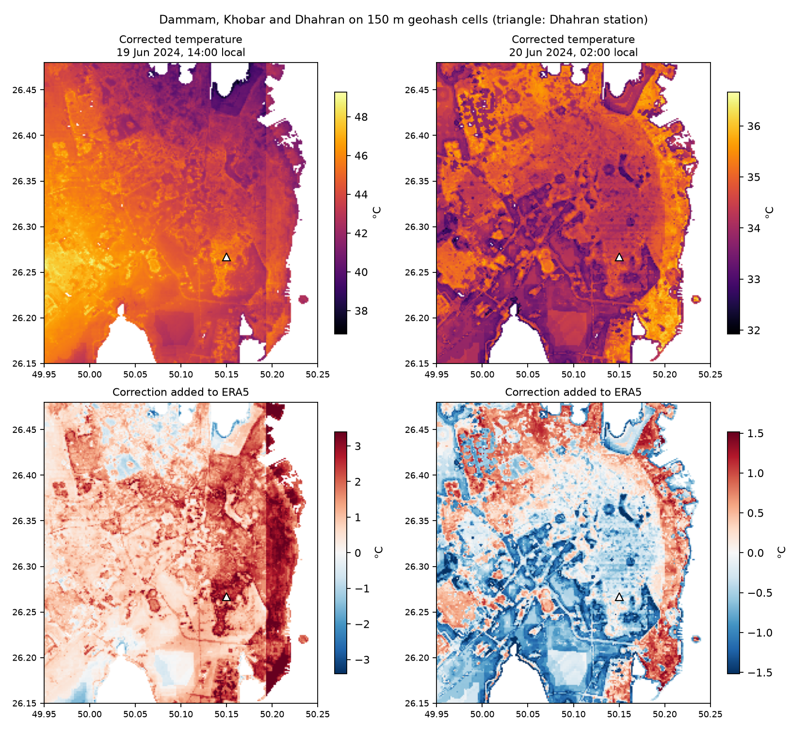
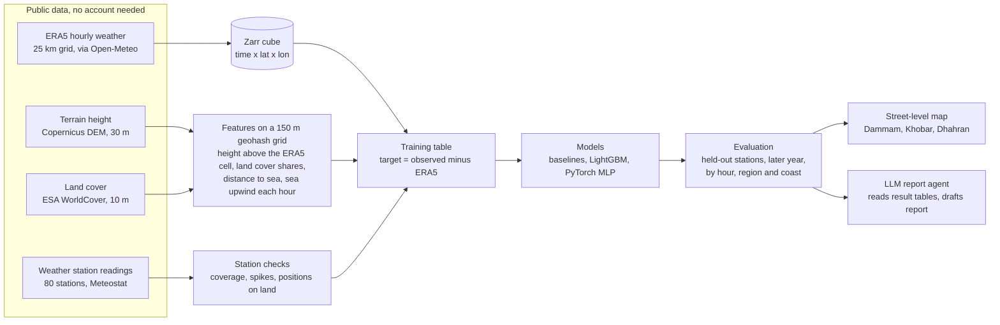
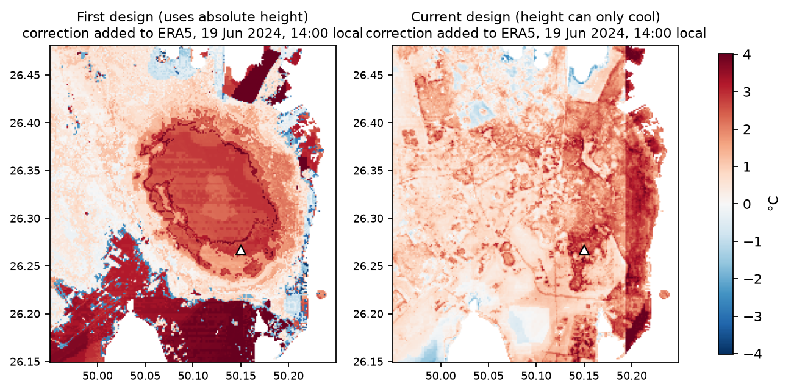
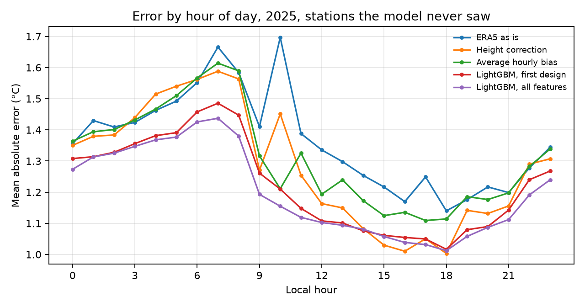

# Gulf Heat Downscaling

**Street-level air temperature for Gulf cities, by learning where global weather data goes wrong.**




## What it is

ERA5 is the dataset most people use for past hourly weather anywhere on Earth. Its grid cells
are about 25 km wide, so along the Gulf coast a single cell mixes sea, desert and city.

This project measures how wrong ERA5's hourly temperature is at 80 weather stations across the
Gulf region, learns a correction from terrain, land cover and the coastline, and applies it on a
150 m grid. The result is a street-level temperature map of Dammam, Khobar and Dhahran in Saudi
Arabia's Eastern Province.

## Why it matters

Heat shapes health, energy use and city planning in the Gulf, and those decisions are made street
by street, not 25 km at a time. I study at KFUPM in Dhahran, where an evening by the water and an
evening 20 km inland feel like different climates. I wanted to know how wrong the standard data
is here, when in the day it is wrong, and whether public maps of the ground explain enough of
that error to correct it.

## Results at a glance

Scored on 2025, a year the model never trained on, at weather stations it never saw. The plan
for this test, including what would count as success, was
[written before any 2025 score existed](reports/test_plan_2025.md).

| | ERA5 as is | This project | Change |
|---|---|---|---|
| Error at new stations, whole region | 1.363 °C | 1.199 °C | **12% lower** |
| Error at new stations, Gulf coast | 1.479 °C | 1.328 °C | **10% lower** |
| Error at Bahrain airport (a known hard case) | 1.84 °C | 1.29 °C | **30% lower** |

Errors are mean absolute errors of hourly 2 m air temperature over 541,905 station-hours at 67
stations. The street-level map itself cannot be scored this way, because no station sits inside
most of its cells, so it is checked separately (see below).

## How it works



1. **Read the coarse weather.** ERA5's hourly temperature, humidity, wind, sunlight and cloud are
   stored in one Zarr cube and read at any point by bilinear interpolation.
2. **Describe every place.** Terrain and land cover are averaged onto a 150 m geohash grid, with
   features for how much higher a site is than its ERA5 cell, what covers the ground nearby, how
   far the sea is, and how much sea lies upwind in each hour's wind.
3. **Learn the error, not the temperature.** The model predicts observed minus ERA5, so ERA5 keeps
   the weather of the day and the model only learns the local correction.
4. **Test it the way a map is used.** Most map cells have no station, so the key score holds whole
   stations out of training and tests on a later year.
5. **Draw the map and the report.** The chosen model corrects every 150 m cell of the three
   cities, and a small LLM agent reads the result tables and drafts a report using only the
   numbers its tools return.

## Fixing the map, not just the score

The first version of the model scored well at stations but drew the Dhahran dome's height
contours onto the map, because it had learned to use height as a stand-in for "inland". No
station sits on the dome, so the station score could not catch it. The current version can only
make higher ground cooler, never warmer, and the dome is gone. Away from the coast at 2 pm, ground
above 25 m used to get 1.74 °C more correction than ground below 10 m. Now the gap is 0.56 °C,
and the height features push the other way (0.19 °C cooler on high ground).



## When in the day ERA5 is wrong

ERA5 is too cold on average (by 0.36 °C at new stations) and worst in the morning. The correction
helps most at those hours.



## How it was tested

- **Two settings.** "Seen stations" tests a later year at stations used in training. "Unseen
  stations" holds whole stations out, which is what a street map needs.
- **Nothing is chosen on the test year.** Model settings and the model used for the map are
  picked by cross-validation on the training years, with whole stations held out.
- **Tested twice.** The first test trained on 2023 and scored 2024 (kept in
  [reports/test_2024](reports/test_2024/)). Studying it showed two problems, Bahrain and the map
  dome. Rather than fix them and score 2024 again, I froze the fixes, moved 2024 into training,
  and scored once on 2025 against the written plan.

<details>
<summary><b>Full 2025 results table</b></summary>

Mean absolute error in °C ([summary.csv](reports/tables/summary.csv)).

| Correction | All, unseen | Gulf coast, unseen | All, seen |
|---|---|---|---|
| None (ERA5 as is) | 1.363 | 1.479 | 1.363 |
| Height only (−6.5 °C per km) | 1.282 | 1.438 | 1.282 |
| Average error at each local hour | 1.309 | 1.399 | 1.303 |
| LightGBM, hourly features | 1.262 | 1.363 | 1.176 |
| LightGBM, + ERA5 cell | 1.244 | 1.410 | 1.053 |
| LightGBM, + ERA5 cell and sea | 1.236 | 1.410 | 1.008 |
| LightGBM, all features (chosen, used for the map) | **1.199** | **1.328** | 0.892 |
| LightGBM, first design (reference) | 1.222 | 1.377 | 0.990 |
| PyTorch MLP, all features | 1.359 | 1.481 | 0.984 |

More breakdowns are in [reports/tables](reports/tables/): by hour, country, season, distance
from the coast and station.
</details>

<details>
<summary><b>Where it falls short</b></summary>

- **The coast is harder.** Within 5 km of the sea the error drops 5%; further inland it drops 16%.
- **Not every station improves.** 18 of 67 get worse at new stations, nine of them on the Gulf
  coast.
- **The map has a seam.** A straight north to south line runs through Khobar, where a feature
  based on ERA5's 25 km grid crosses a model threshold. It was found after the 2025 test, so it
  is reported, not patched.
- **Stations are all at airports and airbases**, so street-level patterns inside the cities are
  a model estimate, not something measured.
</details>

<details>
<summary><b>Data sources</b></summary>

| What | Source | Resolution |
|---|---|---|
| Hourly temperature, dew point, wind, sunlight, cloud | ERA5 through the Open-Meteo archive API | 0.25°, hourly |
| Station air temperature | Meteostat bulk files, observations only | hourly |
| Terrain height | Copernicus DEM GLO-30 | 30 m |
| Land cover | ESA WorldCover 2021 | 10 m |

Training uses 2023 and 2024 (1,275,481 station-hours); every reported score uses 2025.
</details>

<details>
<summary><b>Run it</b></summary>

```bash
uv sync
uv run gulfheat all        # ERA5, stations, features, checks, evaluation, map
uv run pytest
```

The optional report agent needs the `agent` extra and an Anthropic API key:

```bash
uv sync --extra agent
export ANTHROPIC_API_KEY=...
uv run gulfheat report     # writes reports/REPORT.md from the result tables
```

Everything downloads from public sources with no account and is cached under `data/`. The free
ERA5 API allows about 380 one-year grid point downloads a day, so a first run from scratch takes
about three days; an interrupted run picks up where it stopped.
</details>

<details>
<summary><b>Repository layout</b></summary>

```
configs/default.yaml      one config drives every step
src/gulfheat/
  era5.py                 ERA5 download, cache and Zarr cube
  stations.py             station readings and position checks
  geogrid.py              150 m geohash grid
  static_features.py      terrain, land cover and sea features
  dataset.py              training table and feature sets
  models.py               baselines, LightGBM, PyTorch MLP
  evaluate.py             tuning, test settings, breakdowns
  heatmap.py              street-level map
  agent.py                LLM report agent
  cli.py                  `gulfheat <step>` entry point
reports/                  result tables, figures, test plan, first test
tests/                    rules that decide which data is used
```
</details>
